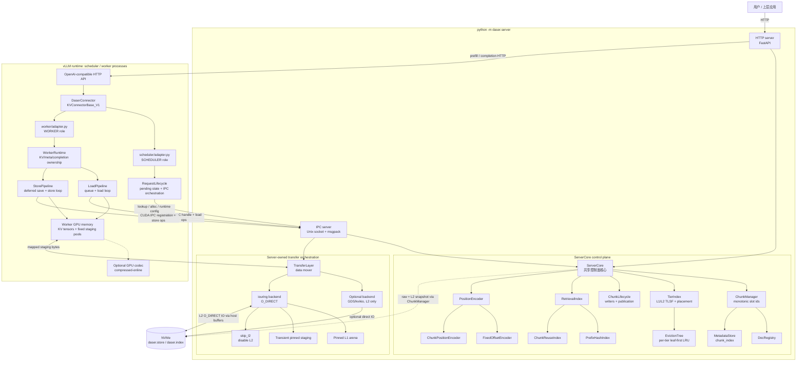
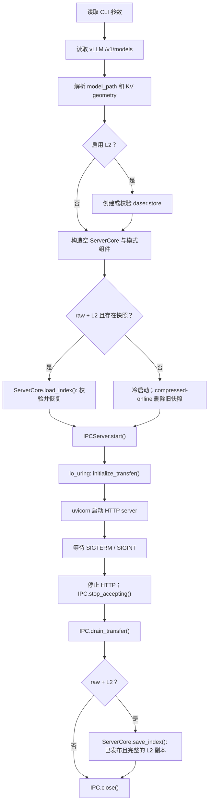

# 整体架构

DaseR 是面向 LLM 推理的 RAG-native KV cache 服务。它作为独立 DaseR
server 进程运行，通过 vLLM `KVConnectorBase_V1` 接入推理流程，将 KV bytes
存入 pinned host L1 和可选 NVMe L2，并在控制面维护 chunk、文档、检索、发布与
分层驻留状态。

---

## 进程拓扑



`ServerCore` 是共享控制面核心，不承载 KV bytes 的数据传输。它协调
`ChunkManager`、`ChunkLifecycle`、`TierIndex`、`RetrievalIndex` 和
`PositionEncoder`，通过 `ChunkManager` 持有 `MetadataStore` 和 `DocRegistry`。
逻辑 slot ID 的分配与物理 extent 分配分开：前者单调递增，后者由每层 TLSF 管理。
发布与淘汰决定 chunk 是否可被 lookup 命中。
HTTP server 直接调用 `ServerCore` 处理文档和推理请求；IPC server 同时
承担 connector 边界适配，控制面 op 发给 `ServerCore`，数据面 op 发给
server-owned `TransferLayer`。

`RetrievalIndex` 和 `PositionEncoder` 在图中展开为当前两套实现。
`--cache-reuse-mode prefix` 选择 `PrefixHashIndex + FixedOffsetEncoder`，
用于 rolling-prefix slot reuse；`--cache-reuse-mode chunk` 选择
`ChunkReuseIndex + ChunkPositionEncoder`。
`ServerCore` 只依赖这两个抽象接口，不感知具体实现。

Transfer orchestration 由 DaseR server 管理。vLLM worker 持有 CUDA context、KV
cache tensor 和 staging buffer，不打开 SSD 文件，也不选择具体 transfer backend；
它将固定 staging pool 的 CUDA IPC handle 注册给 server，后续请求可按 buffer
index 复用 mapping。server 的控制面管理 L1/L2 容量、放置和淘汰，
`TransferLayer` 只在指定偏移之间搬运字节。GDS 是启动时可选 backend；
直接 cuFile 打开失败时可在初始化阶段选择 kvikio compat，运行期不切换后端。

iouring 图里的 `iouring backend` 表示 transfer 执行引擎，逻辑存储层级则是
L1 pinned host memory 和 NVMe 上的 L2 `daser.store` 两个独立层。临时 pinned
staging pool 用于没有 L1 extent 的 IO，不是第三个缓存层。两层各有分配器和容量，
chunk 在每层最多
一个副本，驻留和淘汰都由 server 的 `TierIndex` 与 `EvictionTree` 决定；
iouring transfer 只按 server 给出的 L1 arena 偏移和 L2 文件偏移搬运字节。
默认 store 对 L2 write-through，L1 能接纳时保留 L1 副本；load 从 L1 副本读，没有
时从 L2 读并在可接纳时 promote 进 L1。见
[独立 L1/L2 分层与叶子优先淘汰](tier-residency.md)。

`--skip-l2` 关闭 L2，其余 IPC/control-plane 流程不变：lookup/store 仍然经由
`ServerCore`、`RetrievalIndex` 和 `transfer_store`/`transfer_load` IPC op，
但 KV bytes 只进入 pinned host L1，不创建 `daser.store`，不做 L2 写入，也不在
关机时保存 `daser.index`。store 必须被 L1 接纳，否则失败；chunk 的 L1 副本被
淘汰即离开索引，lookup 只返回仍存在的 chunk，重启后总是冷启动。
该模式和 `gds` 冲突，因为 GDS 需要一个可打开的 L2 store file。

研究开关 `DASER_EXCLUSIVE_TIERS=1` 要求两层都启用：新 store 优先只写 L1，
不能接纳时只写 L2，后台 demotion 把脏 L1 副本写入 L2。promotion 保留 L2 源，
因此不是始终互斥的两个集合。该模式下 `lookup_prefetch` 返回 `tier=None`，
仍可触发普通 readahead；scheduler 使用普通 load，不能启用依赖 lease 的逐层恢复。

---

## 启动流程

DaseR 采用 vLLM-first 启动。先启动 vLLM，声明 connector、IPC socket 和
load 失败时的重算策略：

```bash
vllm serve /path/to/model \
    --port 8001 \
    --no-enable-prefix-caching \
    --kv-transfer-config '{"kv_connector":"DaserConnector","kv_connector_module_path":"daser.connector.daser_connector","kv_role":"kv_both","kv_load_failure_policy":"recompute","kv_connector_extra_config":{"socket_path":"/tmp/daser.sock"}}'
```

lookup 命中不 pin chunk，load 前 chunk 可能被逐出；`kv_load_failure_policy`
设为 `recompute` 时 vLLM 重算这些块，默认 `fail` 会让请求失败。

再启动 DaseR：

```bash
python -m daser.server \
    --vllm-base-url http://127.0.0.1:8001 \
    --store-dir /path/to/daser-state \
    --l2-size 10gb \
    --socket-path /tmp/daser.sock \
    --host 0.0.0.0 \
    --port 2026
```

启动时 DaseR 会：

1. 通过 vLLM `/v1/models` 读取 served model id。
2. 从本地模型 `config.json` 推导 KV geometry 和 slot size；如果 served
   model id 不是本地目录，需要显式传 `--model-path`。
3. 创建或校验 `<store-dir>/daser.store`，容量按 `--tier-grain` 与 TP lane 向下
   取整。
4. 构造空 `ServerCore`；仅 raw + L2 尝试 `ServerCore.load_index()`，校验并恢复
   metadata、L2 放置和已发布检索项；L1 始终为空。
5. 启动 IPC，预先初始化 io_uring transfer 的 host memory，再启动同进程 HTTP。

如果传入 `--skip-l2`，第 3 步不会创建 `daser.store`，第 4 步不会加载
`daser.index`；server 会打印 L1-only/volatile 模式提示。`--skip-l2` 与
`--transfer-mode gds` 同时使用会在配置阶段报错。
`compressed-online` 也冷启动，并删除旧 `daser.index`，防止之后的 raw 运行误读
已经被压缩 record 覆盖的旧快照。

`store_path`、`slot_size`、`block_tokens`、`model_id`、`transfer_mode`、
`l1_size_bytes`、`l2_size_bytes`、`tier_grain`、`skip_l2` 等运行时配置由 DaseR
server 持有。其中 `l2_size_bytes` 是按粒度与 TP lane 对齐后的实际 store 容量，
而不是原始 `--l2-size` 请求值。启动时如果发现更大的 `daser.store`，server 会
截断到对齐容量；小于对齐容量的文件会被拒绝。
vLLM connector 启动后通过 IPC op `get_runtime_config` 拉取，避免 vLLM
参数和 DaseR 参数重复传递后不一致。connector 不用这些容量计算任何位置。
在 `skip_l2=true` 时，`store_path` 为空字符串，`l2_enabled` 为 false。

---

## API 边界

### HTTP server

HTTP server 面向用户和上层应用：

| Method | Path | 用途 |
|--------|------|------|
| `GET` | `/`、`/ui/static/...` | 内置 Web UI 与静态资源 |
| `GET` | `/health` | DaseR 和 vLLM 健康状态 |
| `GET` | `/metrics` | Prometheus 指标 |
| `POST` | `/drain` | 等待服务端 transfer 与 pending chunk 发布 |
| `PUT` / `DELETE` | `/queue_hint/{request_id}` | 登记 / 释放可选 gateway 排队提示 |
| `POST` | `/documents` | chunk 模式上传、prefill 并注册文档；prefix 模式返回 400 |
| `GET` | `/documents` | 列出文档 |
| `GET` | `/documents/{doc_id}` | 查询单个文档元数据 |
| `DELETE` | `/documents/{doc_id}` | 删除文档并释放 chunk 引用 |
| `POST` | `/infer` | 基于指定 docs 和 task 组 prompt 并调用 vLLM completion |

HTTP server 不通过 IPC 自连；它直接调用 `ServerCore` 的文档和 lookup
接口，并通过 `VLLMClient` 调用 vLLM OpenAI-compatible HTTP API。

### IPC server

IPC server 面向 vLLM `DaserConnector`：

| op | 请求字段 | 响应字段 |
|----|----------|----------|
| `get_runtime_config` | - | `runtime_config` |
| `lookup` | `tokens`, `model_id` | `chunks`, `index_epoch` |
| `lookup_prefetch` / `transfer_prefetch` / `release_transfer_lease` | `lease_id`（`lookup_prefetch` 另带 lookup 字段） | lease 的 `spans`/`tier`、promote 字节、`ok` |
| `match_and_alloc` | `tokens`, `chunk_key`, `model_id` | `chunks`, `alloc` |
| `alloc_chunk` | `chunk_key`, `token_count`, `model_id` | `start_slot`, `num_slots`, `pos_offset` |
| `transfer_store` | `payload`, `spans`, `tp_rank`, `tp_size` | `ok`, `bytes`, `chunk_keys` |
| `transfer_load` | `payload`, `spans`, `tp_rank` | `ok`, `bytes`, `l1_segments`, `l2_segments` |
| `transfer_load_runs` | `payload`, `lease_ids`, `tp_rank`, `runs` | `ok`, `bytes` |
| `evict_chunk` | `chunk_key` | `ok` |

完整 op 列表见 [components.md](components.md)，span 与 run 字段见
[tier-residency.md](tier-residency.md)。chunk 在所有 rank 的同层副本有效后发布，
完整 L1 可早于 L2 持久化；没有单独的 commit op。

IPC server 不提供文档管理 op。文档生命周期只属于 HTTP server 和
`ServerCore`。

---

## 关键设计决策

### HTTP server 和 IPC server 共用 ServerCore

两个 server 在同一 DaseR 进程中运行，并共享同一个 `ServerCore` 实例。
这样 HTTP 上传文档产生的 chunk、IPC 分配的 slot、关机保存的 metadata
都落在同一份控制面状态上。

### 两阶段提交

`alloc_chunk` / `alloc_chunks` 只分配逻辑 ID 和 metadata，不预留物理空间，也不把
chunk 插入 `RetrievalIndex`。`place_store` 才分配 extent。server 在
`store_staged` / `store_persisted` 中记录各 rank 的完成状态；当所有 rank 都报告，
且至少一层副本在所有 rank 上完整时发布。完整 L1 可在 L2 写完前发布，lookup
可见不等于已持久化。worker 不发送独立 commit RPC。

### Worker 侧 staging，server 侧 transfer

store 路径不再每层单独发一次写 IO。Worker 在 `wait_for_save` 中按请求进入
顺序将 store 意图加入 FIFO，等 vLLM 报告 request finished 后再提交。后台
`daser-store-io` loop 按 staging pool depth 限制 snapshot/transfer 并发，前一
个任务释放 buffer 后自动推进下一个任务；不依赖后续 vLLM connector step。
raw 路径构造 slot-major staging view，把待保存 blocks 的各层 KV 拷入 staging；
compressed-online 则直接从 live KV 编码到 packed staging。固定 pool 的 CUDA IPC
handle 在初始化时注册，后续通过索引引用并请求 server 执行 transfer。DaseR
server 放置 chunk、搬运字节并在所有 rank 报告后发布，worker 不发起 commit。
staging 由 worker 侧独立的 load/store `FixedCudaStagingPool` 复用，初始化时预分配
bounded buffer；单批和未完成后台 batch 的字节上限会根据 vLLM 分配 KV cache
后的当前可用显存推导，避免固定挤占显存。

load 路径在 `start_load_kv` 中把本 step 的命中 chunk 拆成 bounded staging
batch，引用已注册 staging，请求 server 读回 spans，再批量恢复到 vLLM
KV cache。load 和 store 使用同一套 worker-side staging 抽象。
`wait_for_layer_load` 只在 `layerwise_load` 的 step 上等待对应层；FULL CUDA graph
replay 的 step 由 `start_load_kv` 先等完全部层，所以不需要强制 PIECEWISE。

`WorkerConnectorMixin` 只适配 vLLM hooks；`WorkerRuntime` 集中 KV layout、step
metadata、completion 和 shutdown，内部的 load/store pipeline 各自拥有 queue、
event loop、IPC client、staging lease 和 future。固定 staging pool 由两个 pipeline
共享的 worker memory module 管理；slot-major tensor layout 和 RoPE restore 留在
staging module。

Scheduler 侧同样把 hook adapter 与状态 implementation 分开：request lifecycle
集中持有 pending load/store/alloc/async-save 状态并编排同步 IPC，chunk/prefix reuse
strategy 只生成 store intent，不反向修改 connector 私有状态。

### 后台 asyncio IO loop

vLLM worker 线程不直接运行可重入 event loop。Load/store pipeline 分别拥有
`daser-load-io` 和 `daser-store-io` 后台线程，transfer、staging 注册和取消写者的
异步 IPC 由这些 loop 执行，跨线程任务通过 `run_coroutine_threadsafe` 提交。
独立 loop 避免 cache-hit load 排在后台
store coroutine 后面。

### Transfer backend 启动后不可切换

`python -m daser.server --transfer-mode` 在 server 启动时选择 transfer
system，之后不做运行时切换：

| Mode | 数据路径 |
|------|---------|
| `iouring` | 当前主路径：server 打开 worker CUDA IPC staging buffer，SSD 作为 L2，pinned host memory 作为 L1，两层由 server 放置和淘汰（每层叶子优先 LRU）；L2 使用 `O_DIRECT` io_uring，范围必须 4096-byte 对齐 |
| `gds` | 可选 L2-only 路径：server 打开 worker CUDA IPC staging buffer，使用 kvikio/cuFile；初始化时直接 cuFile 打开失败则选择 compat；不提供 L1、promotion、demotion 或 layerwise runs |

`--skip-l2` 是 `iouring` 的 memory-only 开关：server 仍初始化
`TieredIOUringTransferLayer`，但禁用 SSD 文件、io_uring rings 和 L2 write/read
路径；store 只写 L1，load 只查 L1。`gds` 没有 L1：不分配 pinned arena，prefetch
lease、readahead 和 layerwise load 不可用。

### 在线压缩存储

`--storage-format` 在启动时二选一且不可变：`raw`（默认）或
`compressed-online`。后者对 BF16 KV 做严格无损压缩，只支持
`iouring + prefix + TP=1 + BF16 + block_tokens=128`；不满足条件时
启动直接失败，不回退到 raw。raw 模式的数据路径和持久化语义不变。
与 `--skip-l2` 同开时压缩后的 record 只驻留 pinned memory，容量收益直接作用于
memory-only 缓存。

store 路径：worker 在 GPU 上用 TileLang kernel 直接读取 live KV blocks，编码到
store staging 中的 slot
record（3-bit 主符号 + 3-bit escape 流 + raw escape 字节，默认使用模型无关的
generic codebook；可复现的离线 model-bound calibration artifact 可显式提供）；不可压缩的 slot 以显式 `raw` mode 写出。server 按 record 的
`stored_length` 在每层为 chunk 分配一段连续 extent（L1 在 pinned arena，L2 在
`daser.store`），同一批 store 尽量连续放置，相邻 record 合并搬运。默认按 stored
length 计容量，extent 还需按 `tier_grain` 取整；`--l1-accounting raw` 是按 raw
等价长度收费的 L1 消融选项。默认 store write-through，exclusive 开关改为 L1-first，见
[独立 L1/L2 分层与叶子优先淘汰](tier-residency.md)。

server 在 store 时记录每个 chunk 的 record mode 与 stored length，lookup 命中后把
有序 record 以 `compressed_slots`（`{slot_id, mode, stored_length}`）附在 load
spec 上。scheduler 保留逻辑 slot 到 vLLM block 的对应关系，worker 按压缩字节
而不是 raw slot 数拆 staging batch。worker 的 load span 只指名
`(target_offset, start_slot, num_slots, nbytes)`，server 解析出 L1/L2 位置；
`TransferLayer` 不解析 codec。
io_uring/L1 把压缩 bytes 写入已注册 GPU staging 后，worker 在固定 CUDA stream
上用 fused decoder 解析 slot 内 descriptor table，直接写入真实 fragmented vLLM
KV blocks，不物化完整 decoded staging；同一 decoder 也处理 record 的 `raw`
fallback。逐层路径通过 `daser/compression/layer_major.py` 只取当前层的 plane
bytes，并重定位 staging descriptor。prefix
mode 的 `pos_offset` 必须为 0，decoder 暂不融合 RoPE。

该模式的 index 是易失的：启动时删除旧 `daser.index` 并冷启动，关停时不保存
snapshot，避免之后的 raw 重启把 packed bytes 当作 raw 读。

raw 与 compressed-online 共用同一放置与淘汰路径（每层叶子优先 LRU）。物理相邻
的 L2 读在有界范围内合并成一次 io_uring 读。

vLLM worker 在 DaseR server 可查询前就注册 KV tensor 和预分配 staging，
`kv_connector_extra_config.storage_format` 可以声明期望的格式；server 返回的
immutable `runtime_config.storage_format` 是最终真值，两者不一致时 connector
显式失败，不切换模式。

worker 在 store 时按批调用 online codec。`kv_connector_extra_config.
online_pack_batch_slots`（默认 85）限制一次 codec launch 编码的 raw slot 数，
让长 prefix 分批压缩、在批间让出 GPU 给 vLLM；实际批大小还受单个 store
staging buffer 容量限制，取两者较小值。它只影响 worker 端压缩节奏，不改变
落盘 slot 格式，也不需要与 server 一致。

### Cache reuse mode

`--cache-reuse-mode prefix` 使用 `PrefixHashIndex + FixedOffsetEncoder`，
保持 rolling-prefix slot reuse。`--cache-reuse-mode chunk` 使用
`ChunkReuseIndex + ChunkPositionEncoder`，用于 block-aligned 文档 chunk
复用。

---

## 启动与关机



load 的普通 lookup 不固定 chunk。`kv_load_failure_policy=recompute` 处理
lookup 与实际 load 之间的淘汰竞态；详见[数据流程](flows.md)。
