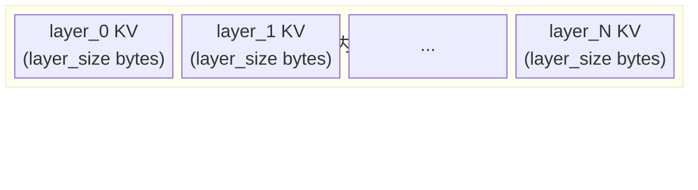

# 组件详解

## 组件职责

| 组件 | 进程 | 职责 |
|------|------|------|
| `DaserConnector` | vLLM | vLLM `KVConnectorBase_V1` 入口；保留在 `daser/connector/daser_connector.py` 供 `kv_connector_module_path` 加载 |
| `SchedulerConnectorMixin` | vLLM scheduler | `daser/connector/scheduler/adapter.py`；适配 vLLM scheduler hooks，不拥有请求 lifecycle 状态 |
| `RequestLifecycle` | vLLM scheduler | 集中 lookup、pending load/store/alloc/async-save、slot 分配、preemption、completion 和 connector metadata 构造 |
| `WorkerConnectorMixin` | vLLM worker | `daser/connector/worker/adapter.py`；适配 vLLM worker hooks，不拥有 pipeline 状态 |
| `WorkerRuntime` | vLLM worker | 集中 KV layout、启动期 kernel warmup、step metadata、load/store completion 和 shutdown，组合两个独立 pipeline |
| `LoadPipeline` / `StorePipeline` | vLLM worker | 分别拥有 load/store event loop、IPC client、staging lease、future、backpressure 和 transfer plan |
| worker memory module | vLLM worker | 负责 load/store 独立 fixed pool、indexed lease；合计预算上限 6 GiB，还受设备总显存和当前可用显存约束 |
| staging tensor module | vLLM worker | 负责 slot-major KV copy、CUDA producer synchronization 和 RoPE restore，不拥有 request/IPC 状态 |
| `IPCClientSync` | vLLM scheduler | 阻塞式 Unix socket 客户端，用于 `get_runtime_config`、`lookup`、`alloc_chunk` |
| `IPCClientAsync` | vLLM worker | asyncio Unix socket 客户端，用于 `transfer_store`、`transfer_load`、`transfer_load_runs` 和 staging 注册 |
| `TransferLayer` | DaseR | `daser/transfer/base.py`；server-owned KV 数据传输抽象，由 `IPCServer` 按 runtime config 初始化 |
| `TieredIOUringTransferLayer` | DaseR | `daser/transfer/iouring/layer.py`；当前主路径，按 server 给定的 L1 arena 偏移和 L2 文件偏移搬运字节。持有 pinned arena、staging pool 和可选 `L2IoEngine`，拷贝逻辑在 `copy_ops`；`--skip-l2` 即不构造 `L2IoEngine` |
| `GDSTransferLayer` | DaseR | `daser/transfer/gds/`；可选兼容 backend，封装 kvikio cuFile / compat IO，只实现 L2 子集；backend 在初始化时选定，运行期不可切换 |
| `L2IoEngine` | DaseR | `daser/transfer/iouring/l2_engine.py`；打开已有 store 文件，io_uring positioned I/O、写门和读条带 |
| `python -m daser.server` | DaseR | CLI 入口；解析配置，构造 `ServerCore`，启动 HTTP server 和 IPC server；仅 raw + L2 模式恢复和保存 index |
| `HTTP server` | DaseR | `daser/server/http/`；FastAPI routes、tokenize/chunk、vLLM HTTP 调用、文档 API 和 `/infer` |
| `IPCServer` | DaseR | `daser/server/ipc/server.py`；Unix socket lifecycle、msgpack framing、op→handler dispatch table |
| `ServerCore` | DaseR | 共享控制面核心；管理 chunk、doc、retrieval、position 状态 |
| `ChunkLifecycle` | DaseR | `daser/server/chunk_lifecycle.py`；chunk commit/写者归属/淘汰状态 + commit waiter，由 `ServerCore` 持有 |
| `ChunkManager` | DaseR | `daser/server/chunk_manager.py`；单调 slot id 分配、`MetadataStore` / `DocRegistry` 组合和 index 持久化 |
| `TierIndex` | DaseR | `daser/server/tiers.py`；每个 chunk 的 L1/L2 副本、两层 `TlsfAllocator`、放置、接纳、promotion 记账和每层指标 |
| `EvictionTree` | DaseR | `daser/server/eviction.py`；按前缀链 `parent_key` 的单一拓扑和每层叶子优先 LRU 候选堆，由 `TierIndex` 持有 |
| `MetadataStore` | DaseR | `chunk_index` 内存状态 |
| lossless KV codec | shared production module | `daser/compression/`：slot header/descriptor 格式、静态 codebook 和 CPU reference encode/decode；`daser/ops/` 的 TileLang kernel 在 worker 上做在线 pack 和 fused restore |
| `DocRegistry` | DaseR | `doc_id -> DocEntry` 文档状态 |
| `RetrievalIndex` | DaseR | cache lookup 抽象；当前实现为 `PrefixHashIndex` 和 `ChunkReuseIndex` |
| `PositionEncoder` | DaseR | position offset 抽象；当前实现为 `FixedOffsetEncoder` 和 `ChunkPositionEncoder` |

---

## 控制面状态边界

`ServerCore` 是 HTTP server 和 IPC server 共享的控制面协调器。它本身不做
KV bytes 的 load/store，而是把请求分发给更窄的组件：slot 分配交给
`ChunkManager`；它组合 `MetadataStore` 和 `DocRegistry`，分别保存 chunk 与文档
状态。cache lookup 交给 `RetrievalIndex`，position offset 交给
`PositionEncoder`。chunk 的 commit/写者归属/淘汰状态和 commit waiter 由
`ChunkLifecycle` 集中维护，保证这几个并行集合的状态转换一致。

`ChunkManager` 和 `MetadataStore` 刻意保持分离。`MetadataStore` 是纯状态容器，
保存 `chunk_key -> ChunkMeta` 的 `chunk_index`（含前缀链 `parent_key`）和移除
计数，不负责序列化。`ChunkManager` 分配单调递增、不复用的 slot id（只是身份，
不是物理地址），并提供快照读写。`ServerCore.save_index` / `load_index` 协调
metadata、L2 placement 和检索索引的保存与恢复。物理位置和淘汰由 `TierIndex` 与
`EvictionTree` 决定：store 放置时每层不足才淘汰该层候选，见
[独立 L1/L2 分层与叶子优先淘汰](tier-residency.md)。

`DocRegistry` 记录用户文档视角的状态：`doc_id`、title、原始 token 数、
chunk 列表和每个 chunk 是否仍被 cache 命中。`ChunkManager` 只关心 chunk 身份；
当 chunk 被淘汰时，`ServerCore` 通知 `DocRegistry` 更新文档的 cached mask。
因此一个是文档目录，一个是 chunk id allocator，二者不能合并。

L1 与 L2 驻留都由 server 的 `TierIndex` 维护：每个 chunk 每层最多一段 extent，
L1 在 pinned arena 中，L2 在 `daser.store` 中。transfer layer 只按给定偏移搬运
字节，不保存驻留状态。L1 重启后为空，但运行中可能持有 chunk 的唯一副本，
不能无条件丢弃。raw + L2 下，只有已发布且具有完整 L2 副本的 chunk metadata
和 L2 偏移随 `daser.index` 持久化。

`--skip-l2` 下 L2 关闭：不分配 `daser.store`，不创建 io_uring rings，也不保存
或恢复 `daser.index`。store 必须被 L1 接纳，lookup 只返回 L1 副本仍存在的 chunk；
进程重启后冷启动。

`compressed-online` 下 record 长度是 codec 的 `stored_length`，`TierIndex` 为
每个 chunk 记录 record 长度，lookup 回复的 `compressed_slots` 只携带
`{slot_id, mode, stored_length}`，位置由 server 在 load 时解析。codec metadata
不进入分配器，transfer backend 也不解析 codec。该模式的索引是易失的，不保存也
不恢复 `daser.index`。

---

## 存储布局

启用 L2 时，DaseR 在 `--store-dir` 下使用以下文件：

- `daser.store`：L2 KV 数据文件，尝试设 NOCOW 后 fallocate；大小为
  `round_down(l2_size / tp, G) * tp`。内部按 TP lane 均分，由 `TlsfAllocator`
  分配 chunk extent。
- `daser.index`：raw 模式的 msgpack metadata 快照，正常关机保存、启动恢复。

`compressed-online` 下压缩 record 按 `stored_length` 紧密放在 chunk extent 内，
索引仅保存在内存中：启动时删除旧 `daser.index` 并冷启动，关停时不写入。

当 `--skip-l2` 启用时，这两个文件都不会由当前运行创建或更新；`--store-dir`
仍可作为 socket 等运行文件的所在目录。


每个 chunk extent 内 record 在 4 KiB 偏移上首尾相接，extent 起点和长度按 `G`
对齐。raw record 是一个 slot，保存一个 vLLM KV block 的所有层：



层内保持 plane-major 顺序 `[2, block_tokens, heads, head_dim]`，因此每个
(layer, K/V) plane 都是一段连续字节，也是压缩 codec 的独立 record。vLLM 按
connector 要求的 `BLNHC` 布局分配一个共享 buffer，物理顺序为
`[blocks, layers, block_tokens, heads, 2, head_dim]`，并给每层传入
`[blocks, heads, block_tokens, 2 * head_dim]` 视图。worker 注册时校验这些视图
来自同一 buffer 且按层等距，据此构造逻辑视图
`[blocks, layers, 2, block_tokens, heads, head_dim]`；staging copy 通过该 strided
视图完成 K/V 交错与 plane-major 之间的转换，codec 和 fused RoPE restore
kernel 直接按物理布局寻址 vLLM KV。

slot size 从模型 `config.json` 推导：

```text
slot_size = num_kv_heads * head_dim * 2 * num_layers * block_tokens * dtype_bytes
local_slot_size = slot_size / tensor_parallel_size
```

偏移由 server 解析（connector 不计算）：

```text
record_offset(chunk, i) = rank * lane_bytes + copy.offset + sum(record_sizes[:i])
layer_offset(raw record, layer_idx) = record_offset + layer_idx * layer_size
```

压缩 slot envelope 的逻辑结构为：

```text
4 KiB-aligned slot header + per-layer K/V plane descriptors
low-byte streams + packed high-byte symbols + escape-prefix tables + escapes
4 KiB padding (stored_length ends here)
```

每个 BF16 scalar 的 low byte 原样保存。high byte 使用该 layer/K/V 的 15-entry
generic static codebook（可由离线 model-bound calibration artifact 显式替换）；在线 packed record 用 3-bit 主 symbol stream，7 以上的 code
通过 packed escape stream 表示，无法由次级表表示的值再写入 verbatim raw
escape bytes。generic codebook 是启动期默认常量；离线 calibration artifact
必须绑定模型身份和 plane-major 几何，单次请求不自适应更新。

每个 chunk 有一段连续 slot id（`ChunkMeta.start_slot`、`num_slots`），id 单调
递增、不复用，只表示身份。每层空闲空间由该层 `TlsfAllocator` 表示，L2 分配器在
加载时由持久化的 chunk L2 偏移重建。

---

## 可插拔接口

### RetrievalIndex

```python
class RetrievalIndex(ABC):
    async def lookup(self, tokens: TokenSequence, model_id: str) -> list[RetrievalMatch]: ...
    def candidate_keys(self, tokens: TokenSequence, model_id: str) -> set[str]: ...
    def continuation_keys(self, tokens: TokenSequence, covered_tokens: int, model_id: str) -> set[str] | None: ...
    def chain_keys(self, tokens: TokenSequence) -> list[str]: ...
    async def insert(self, meta: ChunkMeta) -> None: ...      # base: primary _index
    async def remove(self, chunk_key: str) -> None: ...       # base: primary _index
    def _on_insert(self, meta: ChunkMeta) -> None: ...        # hook for secondary index
    def _on_remove(self, chunk_key: str, meta: ChunkMeta | None) -> None: ...
```

子类初始化主 `_index`（按 `chunk_key`），base 实现 `insert`/`remove`。
子类实现 `lookup`，需要维护二级结构时覆盖 `_on_insert`/`_on_remove` 钩子。
`candidate_keys` / `continuation_keys` 用于判断在途写入是否可能扩展命中，
`chain_keys` 用于 queue hint 的前缀链规划。

实现：

- `PrefixHashIndex`：用 `h_i = H(h_{i-1}, block_tokens_i)` 计算 rolling
  prefix key，每个命中对应一个 KV slot，并返回从 prompt 开头连续命中的
  slot 列表。只用主 `_index`。
- `ChunkReuseIndex`：返回多个 block-aligned chunk 命中，用于文档 chunk
  复用；用 `_on_insert`/`_on_remove` 维护按 token-count 分桶的二级索引。

### PositionEncoder

```python
class PositionEncoder(ABC):
    def assign_offset(self, chunk_key: str, token_count: int) -> int: ...
    def get_offset(self, meta: ChunkMeta, target_token_start: int | None = None) -> int: ...
```

实现：

- `FixedOffsetEncoder`：固定 offset，适合 prefix reuse。
- `ChunkPositionEncoder`：为 chunk reuse 分配和读取 chunk position offset。

`daser/server/__main__.py` 根据 `--cache-reuse-mode` 选择 retrieval 和
position 组件。`ServerCore` 只依赖 ABC。

### TransferLayer

```python
@dataclass(frozen=True)
class Move:
    buffer_offset: int     # staging buffer side
    nbytes: int
    l1_offset: int | None = None  # absolute pinned-arena offset
    l2_offset: int | None = None  # absolute file offset

class TransferLayer(ABC):
    async def store(self, buffer, moves) -> StoreHandle: ...   # D2H to L1 (or staging), then L2 write
    async def load(self, buffer, moves, source) -> None: ...   # source: "l1" | "l2"; l2 may also fill l1_offset
    async def promote(self, moves) -> None: ...                # L2 -> L1, no GPU
    async def demote(self, moves) -> None: ...                 # L1 -> L2, no GPU
    async def load_runs(self, buffer, l1_offsets, targets, lengths) -> None: ...
    async def drain(self) -> None: ...
    async def close(self) -> None: ...
    stats, debug_state
```

`StoreHandle.staged` 在源字节被消费（有 L1 时其副本有效）时完成，`persisted`
在 L2 写完成时完成；没有 L2 写时两者一起完成。transfer layer 只接受 server
给出的位置，只保留瞬态状态（在途 IO、
staging buffer、promotion 读），不维护驻留、替换或 lease 状态。

实现：

- `TieredIOUringTransferLayer`：当前主路径。持有一块 pinned arena（L1 偏移索引
  其中）、一个小 staging pool（未接纳 L1 的 store 和未 promote 的读）和可选的
  `L2IoEngine`（`l2_engine.py`，io_uring positioned I/O、写门、读条带）；纯拷贝
  逻辑在 `copy_ops.py`。L2 文件用 `O_DIRECT` 打开，offset/byte count 要求
  4096-byte 对齐。server 保证 extent 在 `io_pins > 0` 时不复用、load 只读已有效的
  extent，因此这里不需要写后写排序或 promotion 过期检测。`--skip-l2` 即不构造
  `L2IoEngine`，不打开 SSD 文件。

- `GDSTransferLayer`：可选兼容 backend，server 通过 CUDA IPC 打开 worker staging
  buffer，再用 kvikio/cuFile 在 GPU buffer 和 SSD file 之间直接传输。只实现 L2
  子集：`store`（`staged == persisted`）、`load(source="l2")`、`drain`、`close`；
  `promote` / `demote` / `load_runs` 不支持。初始化先尝试 direct cuFile；失败时
  可在初始化阶段启用 cuFile compat IO，运行期不切换 backend。

connector 不感知具体 transfer 实现，只发送 `transfer_store` /
`transfer_load` IPC 请求和 CUDA IPC handle。

---

## IPC 协议

传输层为 Unix socket + 4 字节大端长度前缀 + msgpack body。Scheduler
使用同步客户端，worker 使用 async 客户端。

| op | 调用方 | 请求字段 | 响应字段 |
|----|--------|----------|----------|
| `get_runtime_config` | scheduler / worker init | - | `runtime_config` |
| `lookup` | scheduler | `tokens`（或 `token_bytes`）, `model_id`；可选 `external_prefix_queries`, `num_computed_tokens`, `defer_pending` | `chunks: list[dict]`, `index_epoch`（`defer_pending` 遇到在途写者时为 `pending: true`） |
| `index_epoch` | scheduler | - | `index_epoch`（每次移除 chunk 前进） |
| `record_external_prefix_cache` | scheduler | `queries`, `hits` | `ok` |
| `lookup_prefetch` | scheduler | 同 `lookup` + `lease_id` | `chunks`, `spans`, `tier` |
| `transfer_prefetch` | scheduler | `lease_id` | `ok`, `requested_bytes`, `l1_bytes`, `l2_bytes`；失败为 `error` |
| `release_transfer_lease` | scheduler | `lease_id` | `ok` |
| `match_and_alloc` | 工具 / 兼容调用方 | `tokens`, `chunk_key`, `model_id` | `chunks`, `alloc` |
| `alloc_chunk` | scheduler | `chunk_key`, `token_count`, `model_id`, `parent_key` | `start_slot`, `num_slots`, `pos_offset`, `skipped` |
| `alloc_chunks` | scheduler | `chunks: [{chunk_key, token_count, parent_key}]`, `model_id` | `allocations`（每项另含 `chunk_key`） |
| `commit_stats` | scheduler / bench | - | `commit_stats` |
| `live_allocations` | scheduler | `allocations: [{chunk_key, start_slot, num_slots}]` | `chunk_keys` |
| `release_chunk_writer` | scheduler / worker | `chunk_key`, `start_slot`, `num_slots` | `released` |
| `transfer_store` | worker | `payload`, `spans`, `tp_rank`, `tp_size` | `ok`, `bytes`, `chunk_keys` |
| `transfer_load` | worker | `payload`, `spans`, `tp_rank` | `ok`, `bytes`, `l1_segments`, `l2_segments` |
| `transfer_load_runs` | worker | `payload`, `lease_ids`, `tp_rank`, `runs` | `ok`, `bytes`, `transfer_ms` |
| `register_load_staging` / `register_store_staging` | worker init | `payload`（CUDA IPC handle、`buffer_index`、`producer_pid`） | `ok` |
| `transfer_drain` / `init_transfer` | worker / bench | - | `ok` |
| `evict_chunk` | scheduler | `chunk_key` | `ok` |

span、run 表和 `compressed_slots` 的字段见
[tier-residency.md](tier-residency.md) 的 IPC 线格式；所有 L1/L2 偏移由 server
解析，请求里没有文件偏移。

当前 scheduler 主路径分别使用 `lookup`（或 `lookup_prefetch`）和
`alloc_chunk` / `alloc_chunks`，不依赖 `match_and_alloc`。独占分层下
`lookup_prefetch` 不取得 lease，返回空 `spans`、`tier: null` 并按普通 load 继续。

`runtime_config` 包含：

```json
{
  "socket_path": "/path/to/daser.sock",
  "store_path": "/path/to/daser-state/daser.store",
  "slot_size": 2359296,
  "local_slot_size": 2359296,
  "tensor_parallel_size": 1,
  "block_tokens": 16,
  "model_id": "/path/to/model-or-served-id",
  "cache_reuse_mode": "prefix",
  "transfer_mode": "iouring",
  "l1_size_bytes": 1073741824,
  "l2_size_bytes": 9999941632,
  "l1_enabled": true,
  "l2_enabled": true,
  "tier_grain": 65536,
  "l1_lane_bytes": 939524096,
  "l2_lane_bytes": 9999941632,
  "staging_bytes": 134217728,
  "skip_l2": false,
  "storage_format": "raw",
  "l1_accounting": "stored",
  "prefetch_lease_budget_bytes": 0,
  "l2_read_stripe_bytes": 0
}
```

`l2_size_bytes` 是实际文件大小（按 `tier_grain` 与 TP lane 向下取整）。
`skip_l2=true` 时，`store_path` 为空字符串，不存在 L2。runtime config 不携带
每个 chunk 的物理偏移；lane 大小等容量信息由 server 发布，但 connector
不据此计算 L1/L2 位置。旧 `rank_stride_bytes` 和 `total_slots` 字段已移除。

vLLM 的 `kv_connector_extra_config` 可以携带同名 `storage_format` hint。server
的 `runtime_config.storage_format` 是权威值；声明了 hint 时，scheduler 和 worker
都校验它与权威值相同，不一致则显式失败。
IPC 错误以 `{"error": "..."}` 返回，connector client 会转换为
`RuntimeError`。
