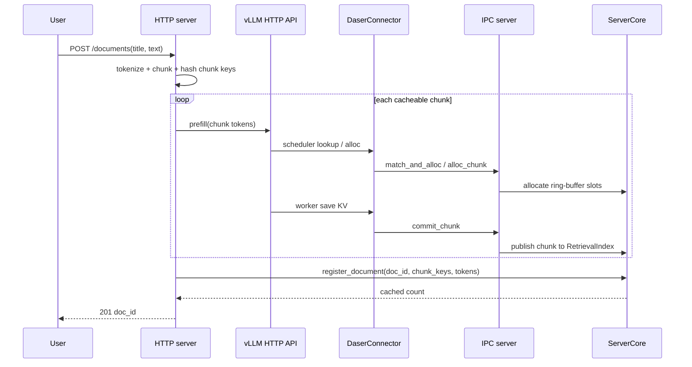
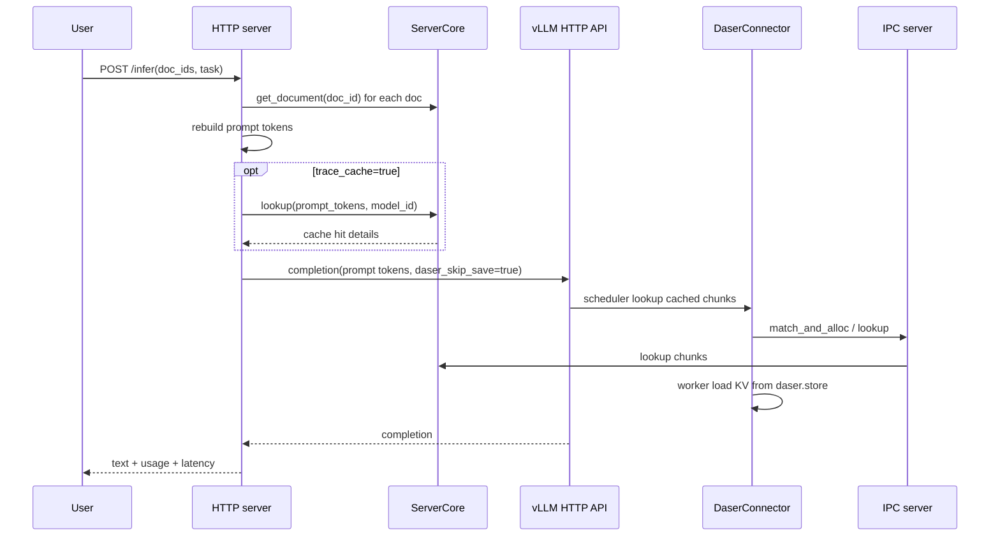
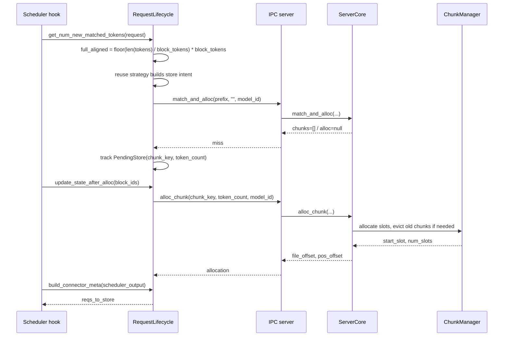
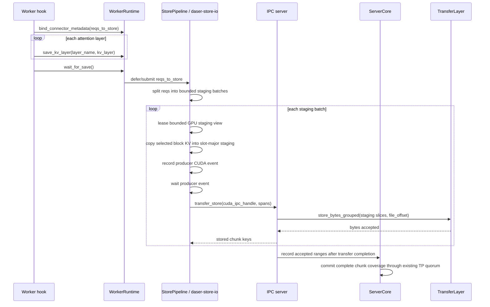
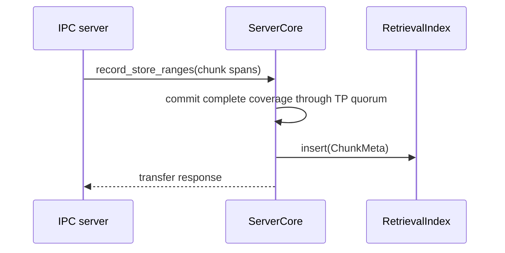
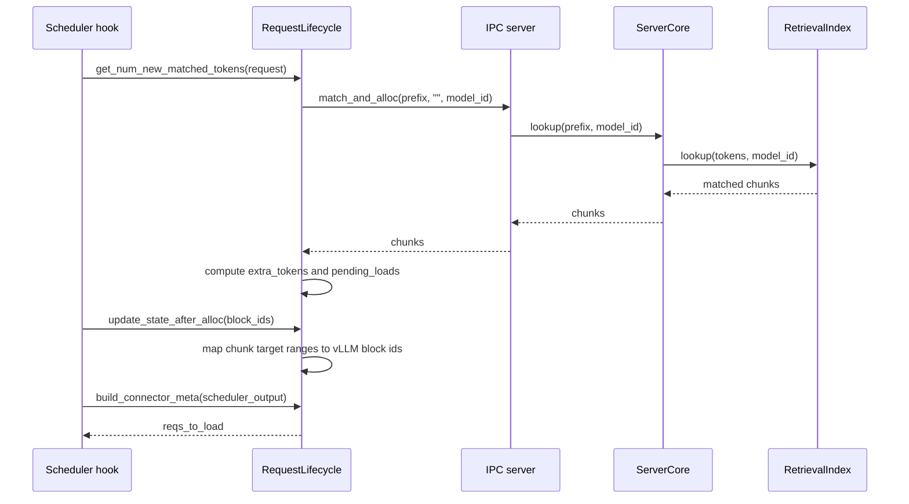
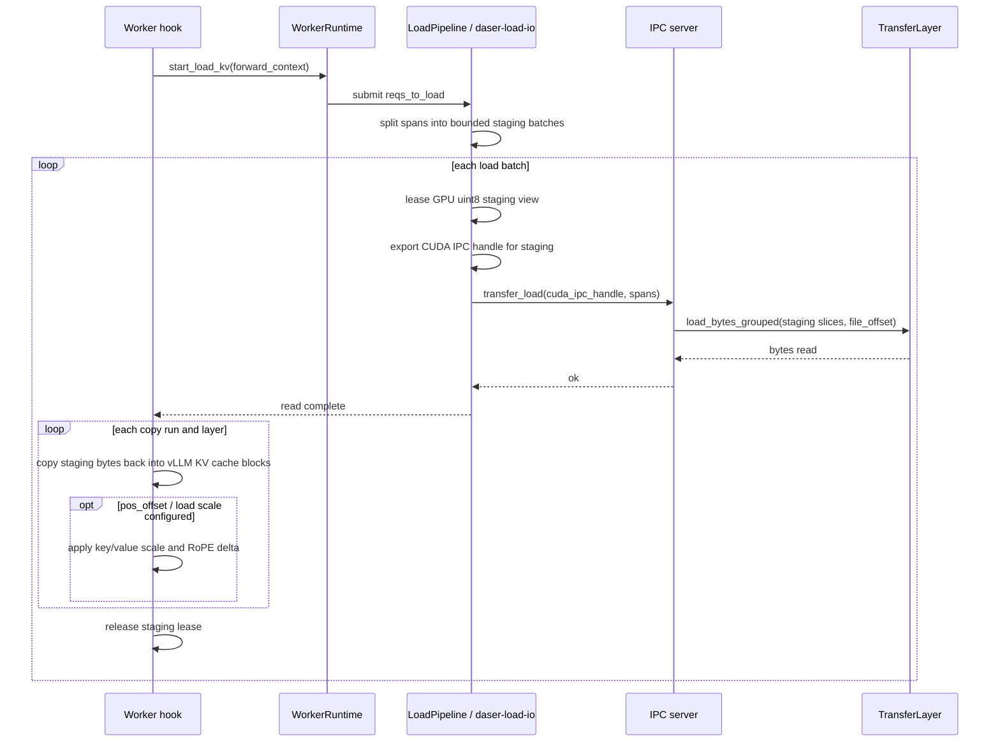
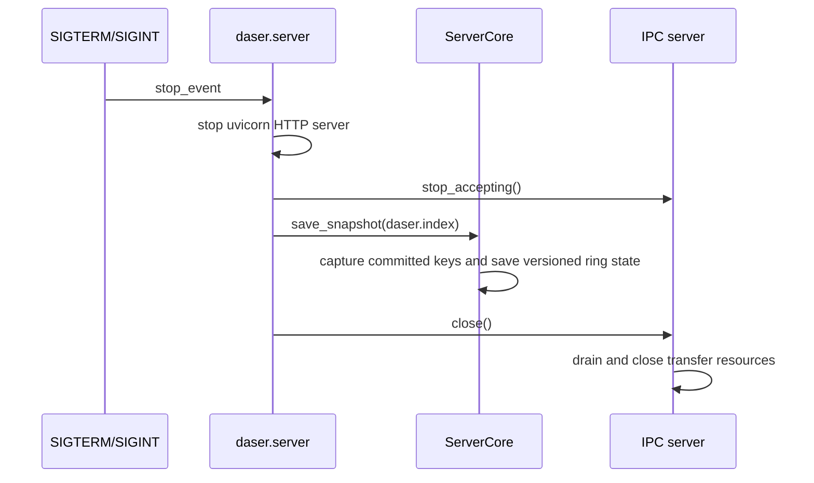

# 数据流程

本文档描述当前 io_uring/L1/L2 主路径。vLLM worker 持有 CUDA context、KV cache
和 staging buffer；DaseR server 通过 IPC 打开 staging mapping，并由
`TransferLayer` 执行 transfer orchestration。GDS 仅是可选兼容 backend，不改变
下面的 connector-to-server IPC 边界。

## 文档上传流程

上传失败时 HTTP server 返回 `502`，不会注册文档。已经成功 commit 的 KV
chunk 可以保留在 ring buffer 中，后续相同内容仍可复用。

---

## 推理流程

`/infer` 会向 vLLM 传 `kv_transfer_params={"daser_skip_save": true}`。文档
chunk 已在上传时缓存，task suffix 通常是一次性的，因此推理请求不再把整个
拼接 prompt 重新写入 DaseR。

---

## KV Store 流程

### 阶段一：Scheduler 查找 miss 并分配 slot

`alloc_chunk` 只预留 metadata，chunk 还不会进入 `RetrievalIndex`。

### 阶段二：Worker staging 和批量写入

`wait_for_save` 只把当前 worker step 的 KV store 意图加入待完成 FIFO，不会
立即读取 live KV cache。`get_finished` 收到 vLLM 的 `finished_req_ids` 后，
按请求进入 FIFO 的顺序提交全部已完成请求。后台 `daser-store-io` loop 使用
staging pool depth 的异步信号量限制实际 snapshot/transfer 并发；前一个 store
释放 staging lease 后，队列中的下一个 store 自动进入，不依赖后续 vLLM
connector step 或 benchmark dummy poll。`shutdown` 会阻塞等待所有 pending
store future 完成。

### 阶段三：Commit 发布

commit 完成后 chunk 才能被 lookup 命中。iouring 路径在 bytes 已进入 L1、
L2 后台写入已调度后即可 commit；这里的 commit 表示缓存发布，不表示 SSD
写入已完成或具备断电持久性。

---

## KV Load 流程

### 阶段一：Scheduler 查找 hit

`PrefixHashIndex` 返回 rolling-prefix 的连续 slot 命中；
`ChunkReuseIndex` 可以返回多个 block-aligned chunks。Scheduler 会确保返回给
vLLM 的 external tokens 是连续可用的前缀范围。

### 阶段二：Worker 一次性加载

`start_load_kv` 返回前 KV cache 已就绪。`wait_for_layer_load(layer_name)` 是
no-op，因为 FULL CUDA graph replay 不保证逐层 Python hook 执行。

---

## 关机持久化流程

raw 存储模式下，`ServerCore.save_snapshot()` 将当前 committed key 集合传给
`ChunkManager.save()`。`daser.index` 同时保存 `snapshot_version=1`、
`committed_keys`、ring-buffer head/tail、完整 `MetadataStore` 和 `DocRegistry`。
快照中的 allocation metadata 可能包含尚未提交的 chunk，恢复资格由
`committed_keys` 明确决定。

启动时先校验快照版本和 committed key 列表，再恢复状态。未提交 allocation
会被移除，其 slot 转为 SKIP，文档中对应的 cached mask 置为 false；保留 chunk
的物理位置不变。随后 `ServerCore.rebuild_retrieval_index()` 只重建保留下来的
committed chunk。旧格式快照缺少发布状态，不能安全推断哪些 bytes 可复用，
因此拒绝加载并冷启动。`--skip-l2` 和 `compressed-online` 仍不保存或恢复索引。

收到 SIGTERM/SIGINT 后，server 停止 HTTP 服务和 IPC 新连接入口，保存快照，
再等待已提交给 transfer 的后台工作并关闭资源。该流程不等待 connector 侧所有
尚未提交的 store。未提交 chunk 即使已有部分 SSD bytes，也不会在恢复后命中。
已经 commit 但尚未绑定文档的 orphan chunk 可以保留并在后续上传时复用。
快照记录的是缓存发布状态；此流程不提供事务式数据与索引提交或断电恢复保证。
